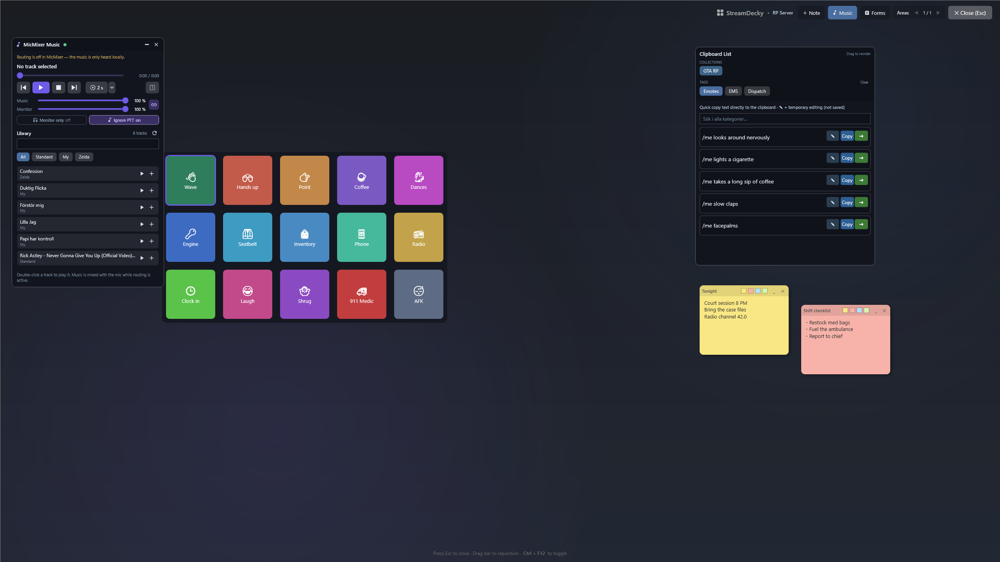

# StreamDecky

StreamDecky is a software command deck for Windows. Press a global hotkey or a
gamepad combo and a fullscreen overlay opens on top of your game: a grid of
macro buttons, ready-made chat lines, fill-in forms, and sticky notes. Click
something and StreamDecky hands focus back to the game and sends the keystrokes
or text there. No Stream Deck hardware is involved; it's all software.

[**Download for Windows**](https://github.com/benjibutten/StreamDecky/releases/latest)
· Windows 10/11 · installer or zip · self-contained, no .NET install · Apache-2.0



## What you can do with it

- Play on roleplay servers like FiveM. Fire emotes and animations from one-press
  buttons (`open chat → /e dance → Enter`), keep your `/me` and `/do` lines in a
  searchable quick-text panel, and pin radio channels or plates as sticky notes
  over the game.
- Fill in the same paperwork again and again. Build a form once, with text
  fields, choice fields, auto-incrementing case or invoice numbers and
  `{date}`/`{time}` tokens, and fill it from the overlay into a dispatch report
  or a real-world canned reply.
- Keep your hands on the controller. Open the overlay with a recorded gamepad
  combo and navigate it with the D-pad or stick.

The overlay also has a writing box that fixes spelling and answers short
questions through DeepSeek, and a widget that remote-controls MicMixer's music
player. The [manual](docs/manual.md) describes all of it.

## Install

Download the installer from the
[latest release](https://github.com/benjibutten/StreamDecky/releases/latest) and
run it, or install with winget:

```powershell
winget install --id BenjiButten.StreamDecky --exact
```

winget installs the zip version and keeps it updated with `winget upgrade`. The
zip also runs from any folder you extract it to, without administrator rights.

Releases are unsigned, so Windows SmartScreen may show **Windows protected your
PC**. Since `v2026.7.5` every download has a `.sha256` file next to it, and
[INSTALLATION.txt](INSTALLATION.txt) shows how to check it before you choose
**More info → Run anyway**. Releases are built by GitHub Actions from the tagged
commit. See the
[code signing policy](https://benjibutten.github.io/StreamDecky/code-signing-policy.html)
and the [privacy policy](https://benjibutten.github.io/StreamDecky/privacy.html).

## Get started

1. Start StreamDecky from the Start menu and build a deck in the editor.
2. Set the overlay hotkey in **Settings**, then open the overlay over your game.
3. Optionally import a ready-made profile through **Settings → Import Profile**:
   [FiveM Roleplay](docs/templates/fivem-roleplay.json) or
   [Canned Replies](docs/templates/canned-replies.json). It is added next to your
   own profiles, never over them.

If your game runs as administrator, turn on **Settings → General → Run
StreamDecky as administrator**. Otherwise Windows drops the keys StreamDecky
sends to the game.

## Documentation

- [Manual](docs/manual.md): every feature, keyboard shortcuts, installing and
  updating, where data is stored, known limitations, and security.
- [Build a FiveM roleplay deck](docs/guides/fivem-roleplay-deck.md)
- [Profile templates](docs/templates/README.md): what's in the ready-made
  profiles and how to import them.
- [Recovery and troubleshooting](docs/recovery-and-troubleshooting.md): failed
  saves, restoring a backup, startup and hotkey problems.
- [INSTALLATION.txt](INSTALLATION.txt), which also ships with every release.

## Building

You need Windows and the .NET 10 SDK.

```powershell
dotnet restore StreamDecky.slnx
dotnet run --project src/StreamDecky/StreamDecky.csproj
```

[CONTRIBUTING.md](CONTRIBUTING.md) covers the tests, the architecture,
publishing, and how releases are made.

## Thanks

StreamDecky is built and maintained by BenjiButten and is free of charge. A
special thank you to [Pixlexi](https://www.twitch.tv/pixlexi), who contributed
the use cases behind the app, tested it hands-on, and gave feedback throughout
development.

If you enjoy StreamDecky and want to give something back, consider gifting a sub
to [Pixlexi](https://www.twitch.tv/pixlexi) on Twitch.

## License

StreamDecky is licensed under the [Apache License 2.0](LICENSE). Redistributions
must keep the attribution in [NOTICE](NOTICE). Third-party components and their
licenses are listed in [THIRD-PARTY-NOTICES.txt](THIRD-PARTY-NOTICES.txt); that
file, the license, and NOTICE are included in published distributions.

Releases up to and including `v2026.7.3` remain available under the MIT terms
they were published under. Source from the Apache-2.0 relicensing commit onward
is licensed under Apache-2.0.
